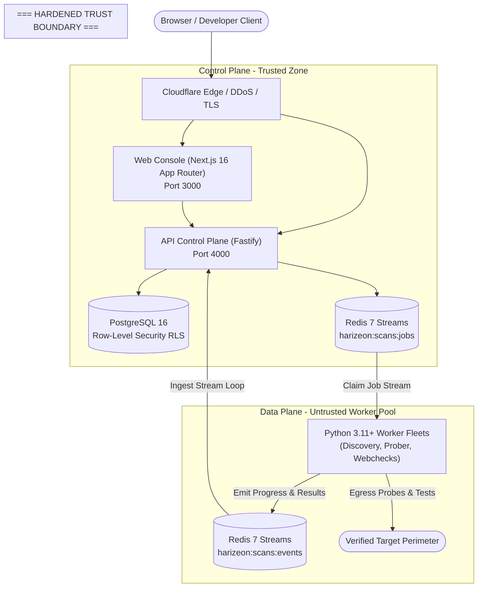
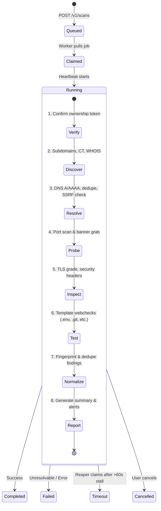
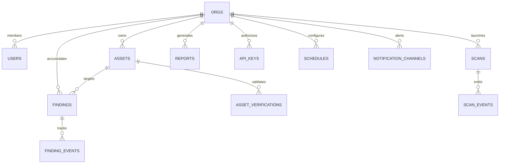

# HARIZEON — Platform Architecture & Engineering Hand-off Specification

> **Platform Mission:** Security infrastructure, provisioned like cloud.  
> **Target Audience:** The security control plane for teams too small to have a security team.  
> **Source of Truth:** [`harizeon-master-plan.txt`](file:///f:/project/Harizeon/harizeon-master-plan.txt) & [`AGENTS.md`](file:///f:/project/Harizeon/AGENTS.md).

---

## 1. Executive Summary & Core Value Proposition

Harizeon transforms external attack surface management (EASM), perimeter scanning, and security compliance into metered, self-serve, API-first cloud infrastructure. 

```
+---------------------------------------------------------------------------------------+
|                                    THE HARIZEON VALUE LOOP                             |
|                                                                                       |
|   1. Verify Domain        2. Auto-Discovery         3. Autonomous Scan    4. Fix & Report  |
|   (Cryptographic DNS) ->  (CT Logs & Subdomains) -> (8-Phase Engine)   -> (Exec/Tech PDF)  |
+---------------------------------------------------------------------------------------+
```

### Core Operating Principles
1. **Zero Unverified Scanning (§12):** Strict cryptographic ownership verification (DNS TXT token or HTTP well-known token) is mandatory before active scanning. No bypasses, no debug flags.
2. **Control Plane / Data Plane Isolation (§06.1):** High-availability web console and Fastify API are completely severed from the untrusted Python worker scanner pool. Workers possess zero database credentials and zero access to customer secrets.
3. **Pure Monochrome Visual Language (§10):** Strict black-and-white visual identity (`--color-*: initial`), sharp geometry (`rounded-none`, `0px` border-radius), and data-dense monospace typography.

---

## 2. System Architecture & Plane Topology

Harizeon is strictly decoupled into distinct operational planes separated by hardened trust boundaries:



### Plane Directory Matrix

| Directory | Plane / Responsibility | Tech Stack | Allowed Operations | Forbidden Operations |
| :--- | :--- | :--- | :--- | :--- |
| `web/` | Web Console & UI | Next.js 16 (React 19), Tailwind CSS v4, TypeScript | HTTP calls to `/api/v1/*`, SSR, Server-Sent Events proxies | Direct Postgres connections, direct Redis access, scanner execution |
| `api/` | Control Plane & Business Logic | Fastify, TypeScript, Node.js, `pg` driver | Postgres via non-owner RLS role, Redis Streams (`ScanQueue`) | Executing raw network scanners, running heavy blocking scans in request handlers |
| `worker/` | Data Plane & Security Scanners | Python 3.11+, stdlib `socket`/`ssl`, `httpx`, `dnspython`, `cryptography` | Consuming Redis Stream jobs, egress HTTP/TLS/port probes | **Connecting to Postgres, reading `DATABASE_URL`, reading secrets** |
| `db/` | Database Schemas & Migrations | PostgreSQL 16, SQL migrations (`db/migrations/NNNN_*.sql`) | Sequential schema evolution, append-only audit tables, RLS policies | Modifying existing applied migrations, running migrations under non-owner role |

---

## 3. Technology Stack Reference

### 3.1 Frontend Web Console (`web/`)
- **Framework:** Next.js 16.0+ with Turbopack and React 19.
- **Language:** TypeScript 5.x with `strict: true`.
- **Styling:** Tailwind CSS v4 with custom monochrome tokens:
  - Background: `--bg-canvas` (pure white `#ffffff` or dark `#000000`).
  - Text: `--text-ink` (dense `#000000`), `--text-muted` (`#737373`), `--text-faint` (`#a3a3a3`).
  - Borders: `1px solid var(--border-line)` (`#e5e5e5`).
- **State & Server Boundaries:** Server-Side Rendered (SSR) layouts and authenticated pages, client components for interactive telemetry (`use client`).
- **Fallback Capability:** In-memory mock service (`src/lib/mock-service.ts`) ensures the console can run standalone with or without the backend daemon active.

### 3.2 Backend Control Plane (`api/`)
- **Framework:** Fastify 4.x with async route plugins.
- **Queue Pipeline:** Redis Streams (`harizeon:scans:jobs`, consumer group: `workers`).
- **Telemetry Feeds:** Server-Sent Events (SSE) streaming live scan logs directly to clients via `GET /v1/scans/:id/events`.
- **Tenant Isolation:** Postgres Row-Level Security (RLS) configured via `SET LOCAL harizeon.org_id = '<tenant_id>'` inside per-request transactions.

### 3.3 Data Plane Scanner Engine (`worker/`)
- **Engine Philosophy:** Low-overhead, zero-copyleft dependency tree. Uses Python stdlib `socket` and `ssl` for port scanning and TLS cert extraction; `httpx` for security header evaluation; `dnspython` for DNS records; certificate transparency (CT) logs for subdomains.
- **Scope Discipline (`worker/scope.py`):** Target IP resolution enforces global routability; internal RFC 1918 addresses, loopbacks, and link-local ranges are blocked by default to prevent Server-Side Request Forgery (SSRF).

---

## 4. Scan Engine: The 8-Phase Lifecycle

Every external scan follows an immutable, deterministic state machine:



### Phase Details

1. **Phase 1: `verify`** — Validates that the target's cryptographic verification token is active.
2. **Phase 2: `discover`** — Queries Certificate Transparency logs (`crt.sh`) and wordlists to enumerate subdomains.
3. **Phase 3: `resolve`** — Resolves public DNS records (A, AAAA, MX, NS, TXT). Enforces scope and drops private/RFC 1918 IPs.
4. **Phase 4: `probe`** — Connects to ports (`80, 443, 8080, 8443` in quick/standard; extended range in deep). Identifies open services and captures protocol banners.
5. **Phase 5: `inspect`** — Evaluates TLS cipher suites, certificate validity, expiration, and HTTP response security headers (HSTS, CSP, X-Frame-Options, X-Content-Type-Options).
6. **Phase 6: `test`** — Template-driven HTTP evaluators for dangerous exposures:
   - Exposed `.git/config`
   - Exposed `.env` secrets
   - Exposed `phpinfo()`
   - Unencrypted plain-HTTP without canonical 301/308 redirect
   - Exposed LLM inference daemons (Ollama / vLLM / LM Studio)
7. **Phase 7: `normalize`** — Maps raw scan outputs into standardized Harizeon Findings with unique fingerprints:
   $$\text{Fingerprint} = \text{SHA256}(\text{asset\_id} + \text{check\_id} + \text{location})$$
   Ensures recurring checks update history (`last_seen_at`) rather than creating duplicate rows. Computes scan diff summary: `new`, `resolved`, and `unchanged`.
8. **Phase 8: `report`** — Recalculates organization security posture score (0–100) and dispatches notifications to configured channels.

---

## 5. Database Schema & Data Models

All customer-facing tables carry `org_id` and have Postgres Row-Level Security enabled.



### Key Data Entities

- **`orgs`:** Workspace container (`id`, `name`, `slug`, `country`, `currency`, `timezone`, `billing_status`).
- **`assets`:** Attack surface items (`domain`, `subdomain`, `ip`, `url`). Includes `criticality` (`low`, `medium`, `high`) and `parent_asset_id` for discovered subdomains.
- **`asset_verifications`:** Cryptographic ownership state (`dns_txt`, `http_file`).
- **`scans`:** Scan execution records (`profile: quick | standard | deep | ai`, `status`, `phase`, `progress_pct`, `summary`).
- **`scan_events`:** Streaming log entries powering the console phase rail (`phase`, `level`, `message`, `at`).
- **`findings`:** Deduplicated security issues:
  - `severity`: `critical` (15 penalty pts), `high` (8 pts), `medium` (3 pts), `low` (1 pt), `info` (0 pts).
  - `status`: `open`, `acknowledged`, `fixed`, `false_positive`, `accepted`.
  - `cvss_score`, `cwe_id`, `cve_ids`, `epss_score`, `remediation`.
- **`reports`:** Materialized documents (`executive`, `technical`, `compliance`) with security scores and remediation action plans.

---

## 6. API Reference (Control Plane)

Base URL: `https://api.harizeon.com/v1` (or local proxy `/api/v1/*`)  
Authentication: `Authorization: Bearer hrz_live_...` or session cookie `hz_session`.

### Core Endpoints

| Category | Method | Path | Description |
| :--- | :--- | :--- | :--- |
| **Organization** | `GET` | `/org` | Returns current organization profile & workspace settings |
| | `PATCH` | `/org` | Updates workspace name, timezone, and security boundaries |
| | `GET` | `/org/members` | Lists team members and access roles (`owner`, `admin`, `member`, `readonly`) |
| | `POST` | `/org/members/invite` | Invites a new team member |
| **Assets** | `GET` | `/assets` | Lists assets with filtering (`type`, `criticality`, `verified`) |
| | `POST` | `/assets` | Registers a new asset root |
| | `GET` | `/assets/:id` | Asset detail, including discovered subdomains |
| | `POST` | `/assets/:id/verification` | Initiates ownership verification token generation |
| | `POST` | `/assets/:id/verification/check`| Prompts real-time DNS/HTTP verification check |
| **Scans** | `GET` | `/scans` | Lists scans across all profiles |
| | `POST` | `/scans` | Dispatches new scan job (`asset_ids`, `profile`) |
| | `GET` | `/scans/:id` | Detailed scan status and diff summary |
| | `GET` | `/scans/:id/events` | SSE endpoint streaming real-time phase logs |
| | `POST` | `/scans/:id/cancel` | Terminates active scan job |
| **Findings** | `GET` | `/findings` | Queue of findings with cursor pagination |
| | `GET` | `/findings/counts` | Severity distribution count badge payload |
| | `GET` | `/findings/:id` | Deep inspection details, CVSS, remediation steps |
| | `PATCH` | `/findings/:id` | Status workflow transition (`open`, `acknowledged`, `fixed`, etc.) |
| **Reports** | `GET` | `/reports` | Archive of compiled assessment reports |
| | `POST` | `/reports` | Compiles new Executive, Technical, or Compliance PDF report |
| | `GET` | `/reports/:id` | Fetches compiled report document and attestation |

---

## 7. Developer Guide: How to Implement New Features

### 7.1 How to Add a New Web Check to the Scanner Engine
1. Navigate to [`worker/webchecks.py`](file:///f:/project/Harizeon/worker/webchecks.py).
2. Register a new check in the `CHECKS` registry dictionary:
   ```python
   def check_exposed_backup(resp: HttpResponse) -> bool:
       return resp.status_code == 200 and "application/x-tar" in resp.headers.get("content-type", "")

   CHECKS["exposed_archive"] = {
       "path": "/backup.tar.gz",
       "evaluator": check_exposed_backup,
       "severity": "critical",
       "title": "Exposed Production Archive / Backup",
       "cwe_id": "CWE-552",
       "remediation": "Remove public access to backup archives immediately and configure web server access restrictions."
   }
   ```
3. Add a unit test in `worker/tests/test_webchecks.py`.

### 7.2 How to Add a New Fastify Route Handler
1. Navigate to [`api/src/routes/`](file:///f:/project/Harizeon/api/src/routes/).
2. Define a typed plugin with schema validation:
   ```typescript
   export async function customServiceRoutes(fastify: FastifyInstance) {
     fastify.get("/custom-service", async (req, reply) => {
       const orgId = req.orgId; // Injected by auth middleware
       // Execute tenant-isolated Postgres query
       return { ok: true, data: [] };
     });
   }
   ```

### 7.3 How to Add a New Console Screen in Next.js
1. Create route directory under `web/src/app/(console)/<service-name>/page.tsx`.
2. Follow pure monochrome styling conventions:
   - Use `PageHeader` from `@/components/ui/page-header`.
   - Use `SeverityChip` from `@/components/ui/severity-chip` for severities.
   - Use `DataTable` from `@/components/ui/data-table` for tabular data.
   - Enforce `rounded-none`, pure black/white borders (`border-line`), and uppercase mono headers.

### 7.4 How to Add a Database Migration
1. Create sequential SQL migration file in [`db/migrations/`](file:///f:/project/Harizeon/db/migrations/):
   `db/migrations/0006_custom_service.sql`.
2. Ensure table includes `org_id UUID NOT NULL REFERENCES orgs(id)` and enable RLS:
   ```sql
   ALTER TABLE custom_service ENABLE ROW LEVEL SECURITY;
   CREATE POLICY custom_service_org_isolation ON custom_service
     FOR ALL USING (org_id = current_setting('harizeon.org_id', true)::uuid);
   ```

---

## 8. Verification & Local Development Runbook

### Starting the Local Platform
```bash
# 1. Start Infrastructure (Postgres 16 + Redis 7)
docker compose up -d

# 2. Run Database Migrations
npm run db:migrate

# 3. Start Fastify Control Plane (Port 4000)
cd api && npm run dev

# 4. Start Python Worker Daemon
cd worker && python -m worker.main

# 5. Start Web Console (Port 3000)
cd web && npm run dev
```

### Running Mandatory Verification Gates
Before submitting pull requests or merging changes:
```bash
# Check Next.js types and ESLint
cd web && npm run typecheck && npm run lint

# Check Python worker tests
cd worker && pytest

# Check API control plane tests
cd api && npm test
```
